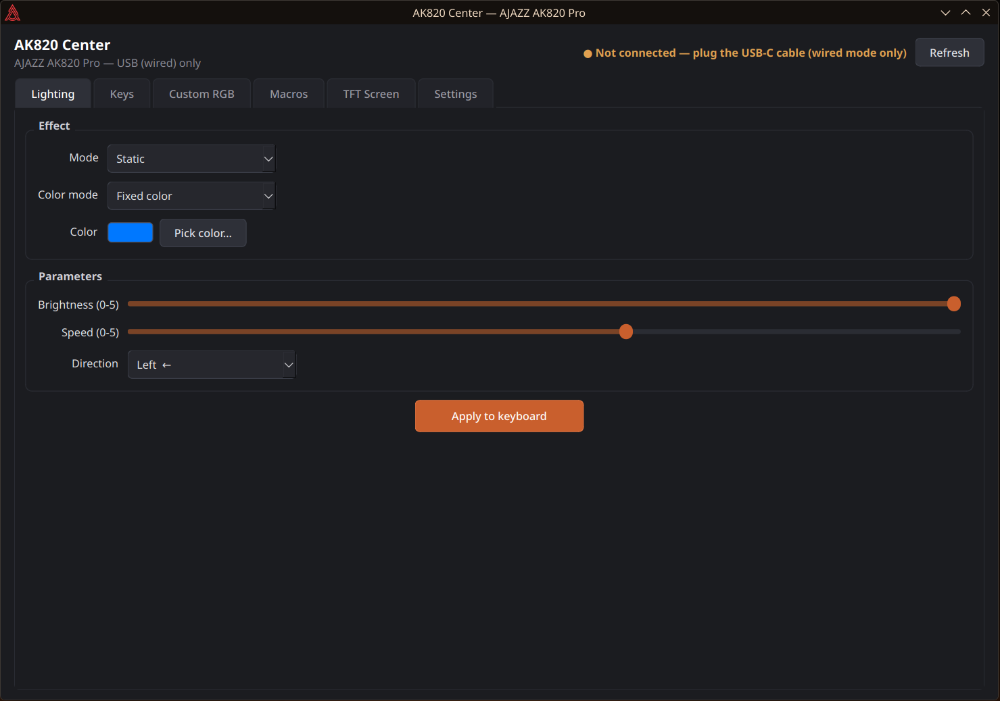
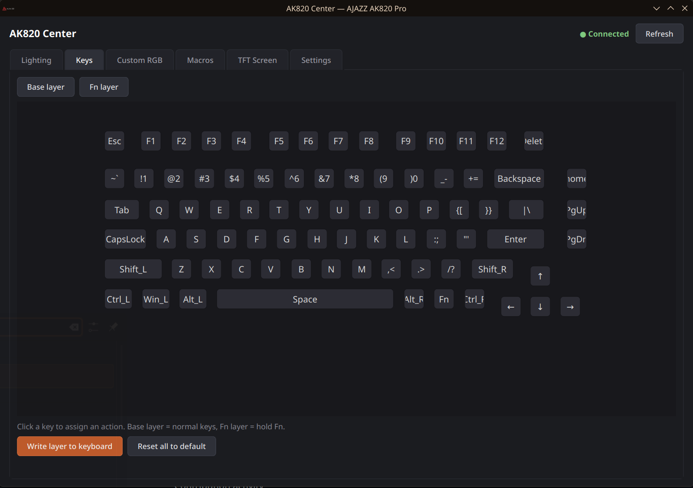
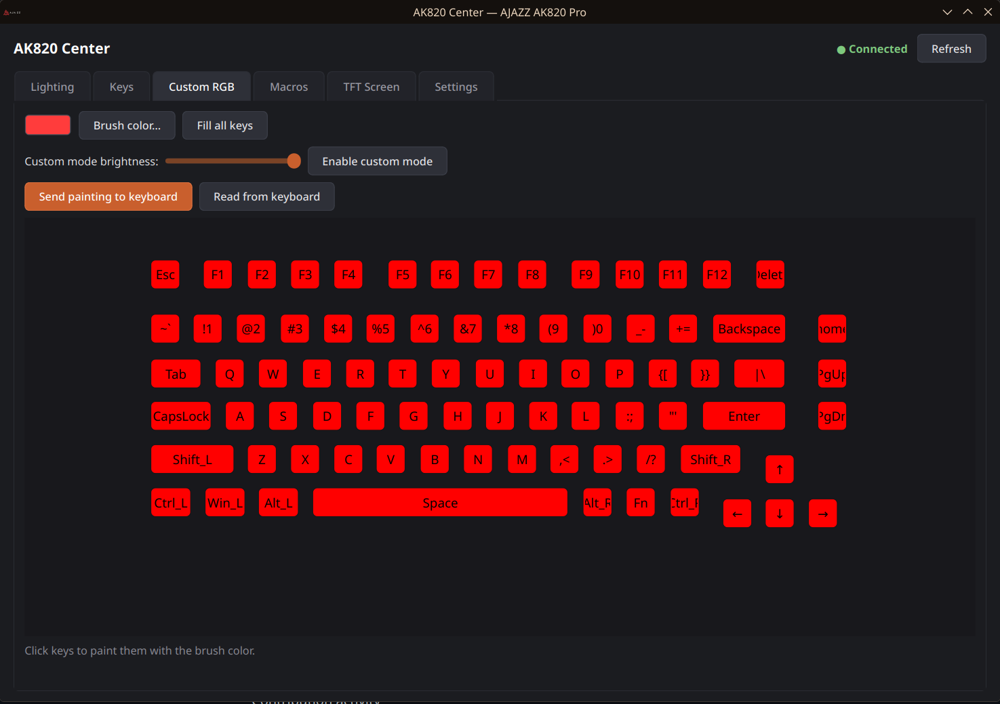
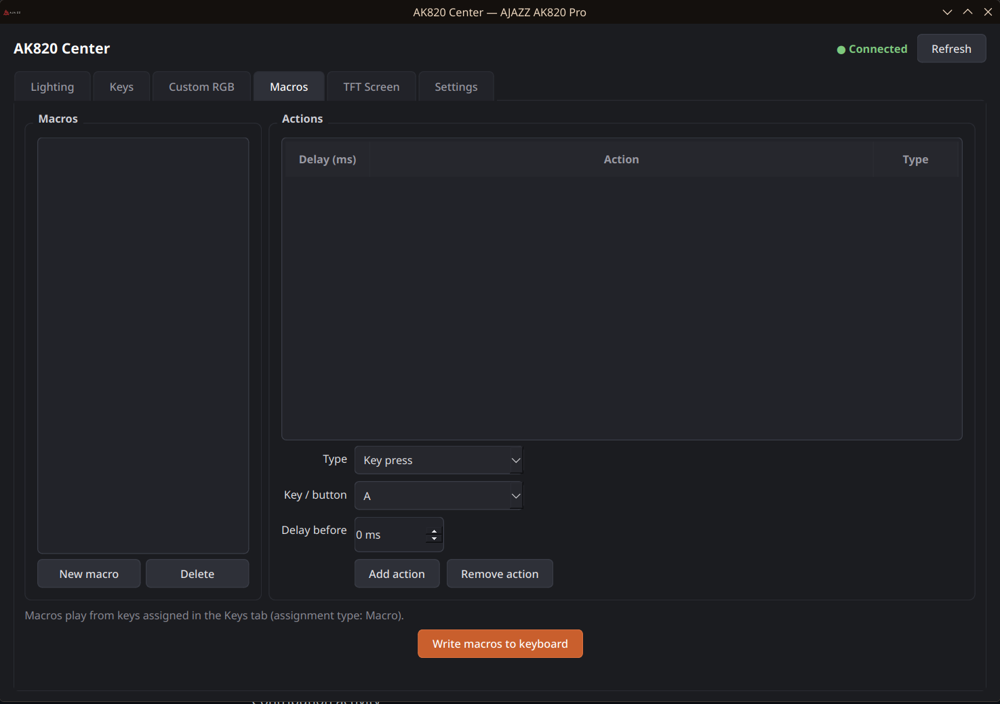
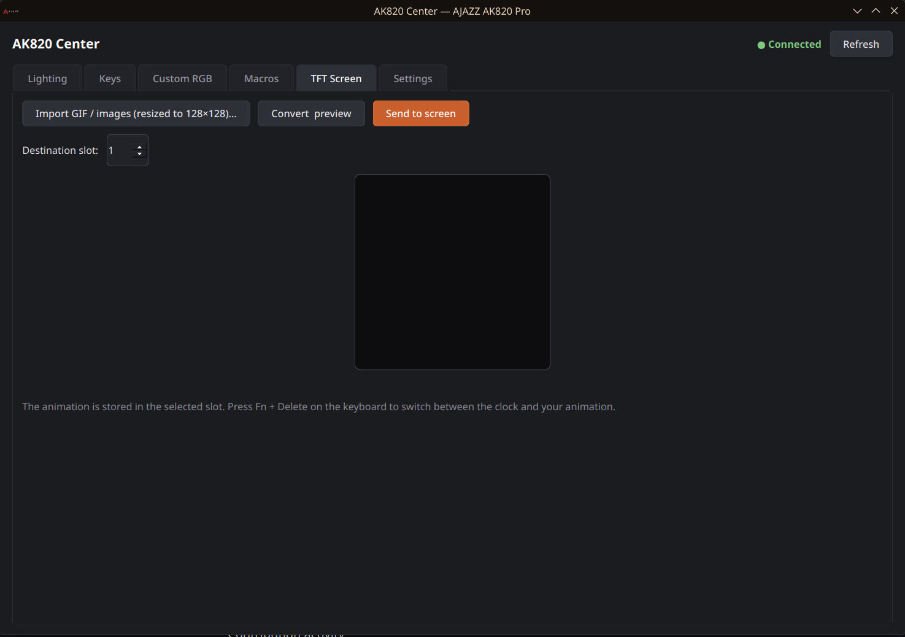
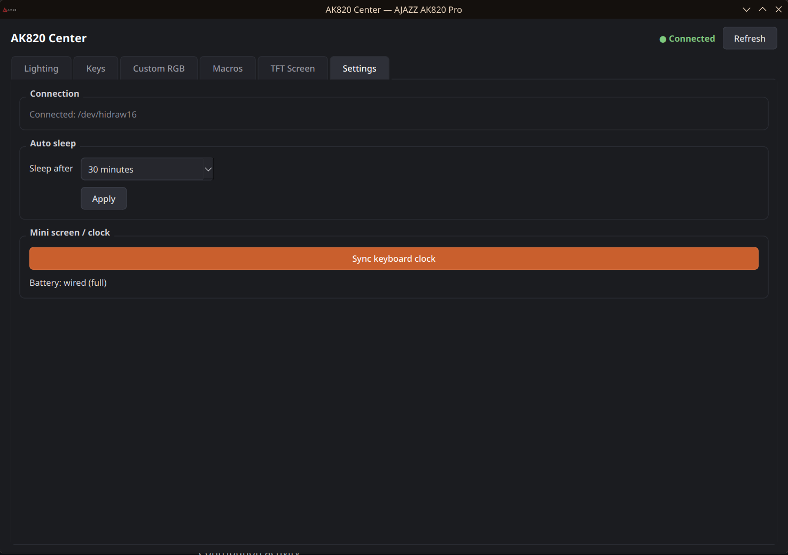

<div align="center">

# AK820 Center

**Native Linux configuration app for the AJAZZ AK820 Pro keyboard.**

Lighting · Key remapping · Per-key RGB · Macros · TFT screen

*Reverse-engineered from the official Windows driver — no vendor software required.*


> [!IMPORTANT]
> **USB (wired) only.** The keyboard must be connected with the USB-C cable.
> The 2.4 GHz dongle and Bluetooth are **not supported** — the control
> protocol targets the wired vendor interface (`0xFF13`).

</div>

---

## Features

| Tab | What it does |
|---|---|
| **Lighting** | All 20 onboard effects (Static, Spectrum, Rainbow Wave, Explode…), fixed/rainbow/reversed color modes, brightness, speed, direction |
| **Keys** | Remap every key on the **base** and **Fn** layers: default, disabled, keyboard + modifiers, multimedia, mouse actions, macros |
| **Custom RGB** | Paint each of the 144 LEDs individually, read/write the color bank stored in the keyboard |
| **Macros** | Up to 100 onboard macros (key press/release, mouse, pauses), written to the keyboard's 3 KB macro memory |
| **TFT Screen** | Upload GIFs/images to the 0.85" 128×128 color screen (RGB565, per-frame delays, 3 slots) |
| **Settings** | Auto-sleep timer (never/1/5/30 min), clock sync, battery level |

State is stored client-side in `~/.config/ak820-center/state.json` — exactly like the official driver keeps its `config.xml`, since the keyboard itself does not expose keymap/macro reads.

## Screenshots

| Lighting | Keys |
|---|---|
|  |  |

| Custom RGB | Macros |
|---|---|
|  |  |

| TFT Screen | Settings |
|---|---|
|  |  |

## Requirements

- Linux (developed on Arch, works on any distro with Qt6)
- Qt 6 (Widgets), hidapi, CMake, GCC/Clang
- **The keyboard connected wired (USB-C)** — 2.4 GHz dongle and Bluetooth
  are not supported (see the note above).

## Build

```bash
# Arch
sudo pacman -S --needed qt6-base hidapi cmake gcc

cmake -S app -B app/build -DCMAKE_BUILD_TYPE=Release
cmake --build app/build -j$(nproc)
```

## Install

```bash
sudo install -Dm755 app/build/ak820-center /usr/local/bin/ak820-center
sudo install -Dm644 resources/rgb-keyboard.xml /usr/share/ak820-center/rgb-keyboard.xml
sudo install -Dm644 packaging/icon.png /usr/share/ak820-center/icon.png
sudo install -Dm644 packaging/ak820-center.desktop /usr/share/applications/
```

**udev permissions** (required to open the HID interfaces):

```bash
sudo cp packaging/99-ajazz-ak820pro.rules /etc/udev/rules.d/
sudo udevadm control --reload-rules && sudo udevadm trigger
```

Then re-login (or add yourself to the `input` group) so the rule applies.

### Arch package

```bash
cd packaging && makepkg -si
```

Prebuilt package (no AUR account needed): download
`ak820-center-<ver>-x86_64.pkg.tar.zst` from the
[releases](https://github.com/Twyx22/ak820-center/releases), then
`sudo pacman -U ak820-center-<ver>-x86_64.pkg.tar.zst`.

## CLI tool

A small standalone test tool is included (`tools/ak820ctl.c`):

```bash
gcc -O2 -Wall -o ak820ctl tools/ak820ctl.c -lhidapi-hidraw

ak820ctl probe                    # enumerate HID interfaces
ak820ctl battery                  # battery level
ak820ctl clock                    # sync keyboard clock
ak820ctl sleep 2                  # 5-minute auto-sleep
ak820ctl light 1 ff0000 5 0 0 0   # mode 1 (static), red, full brightness
ak820ctl tfttest 1                # upload a red/blue test animation to the TFT
```

## How it was made

This app is a full reverse-engineering of the official AJAZZ AK820 Pro Windows
driver (`DeviceDriver.exe` V1.0.0.5). The binary was decompiled with Ghidra to
recover the complete vendor HID protocol:

- 65-byte feature reports on the `0xFF13` control interface
- Transaction framing `START (04 18) → command → data → COMMIT (04 02) → FINISH (04 F0)`
- Keymap banks (`04 11` / `04 27`), custom RGB bank (`04 23`, read via `04 F5`),
  macro storage (`04 19` / `04 15`), TFT upload (`04 72` + 4096-byte chunks on `0xFF68`)

The full wire protocol, verified against the real hardware, is documented in
**[PROTOCOL.md](PROTOCOL.md)**.

> [!NOTE]
> Your keyboard may be a "family A" (web-output firmware) or "family B"
> (feature-report firmware) variant. This app targets the **family B**
> protocol, hardware-tested on `0C45:8009` with product name "AK820".
> A quick check: if `ak820ctl probe` shows a `0xFF13` interface, you're good.

## Credits

- [wsclx/ak820pro-modder](https://github.com/wsclx/ak820pro-modder) — protocol research on both firmware families
- [MemerGamer/AjazzAk820ProUnofficialWebdriver](https://github.com/MemerGamer/AjazzAk820ProUnofficialWebdriver) — WebHID configurator
- gohv/EPOMAKER-Ajazz-AK820-Pro, gusleig/ajazz-ak820-pro-mac, vespovios — legacy packet fixtures

## Disclaimer

This project is not affiliated with or endorsed by AJAZZ. It was built by
reverse-engineering the official driver for interoperability. Everything is
sent at your own risk — the app only uses configuration commands observed in
the vendor software and never touches the ISP/bootloader mode.

## License

[MIT](LICENSE)
